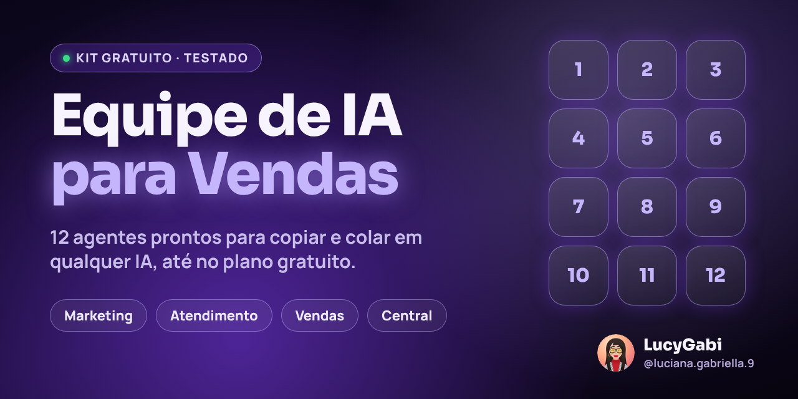

# Equipe de IA para Vendas

Kit gratuito de **Luciana Gabriella (LucyGabi)** com **12 agentes de IA** para pequenos negócios: eles preparam mensagens, posts, anúncios, respostas de WhatsApp, propostas e resumos. Você copia, cola em qualquer IA (ChatGPT, Claude, Gemini ou outra, até no plano gratuito), revisa e decide o que enviar.

**Versão 1 · 9 de novembro de 2026** · **Custo:** gratuito. Este kit não pede login, senha, pagamento nem dados pessoais.

> **O segredo é a Ficha do Negócio.** Os agentes só sabem do seu negócio o que você contar na ficha. Quanto mais verdadeira e completa ela estiver, melhores ficam as respostas. Preencha uma vez e use com todos.

## Comece em 3 passos
1. **Preencha a [Ficha do Negócio](ficha-do-negocio.md)** e guarde num bloco de notas.
2. **Escolha um agente** na tabela abaixo, abra o arquivo e toque no botão de copiar, no canto do quadro cinza. Cole numa **conversa nova** da sua IA.
3. **Troque os dois avisos entre colchetes:** `[COLE AQUI A SUA FICHA DO NEGÓCIO]` pela sua ficha e `[COLE AQUI O QUE VOCÊ QUER]` pelo seu pedido. Envie, leia a resposta e **revise antes de usar**.

Não sabe qual agente usar? Comece pela **10 · Coordenadora**: conte a situação e ela indica o agente certo.

## A equipe
| Nº | Agente | Time | Quando usar |
|---|---|---|---|
| 01 | [Estrategista de Mensagem](agentes/01-estrategista-de-mensagem.md) | Marketing | Antes de tudo: para descobrir o que te faz diferente e como dizer isso em uma frase. |
| 02 | [Criadora de Conteúdo](agentes/02-criadora-de-conteudo.md) | Marketing | Para planejar a semana de posts, Reels, Stories e status do WhatsApp. |
| 03 | [Redatora de Anúncios](agentes/03-redatora-de-anuncios.md) | Marketing | Para criar anúncios pagos no Instagram, Facebook ou Google. |
| 04 | [Qualificadora de Contatos](agentes/04-qualificadora-de-contatos.md) | Atendimento | Quando chegam mensagens novas e você quer saber quem atender primeiro. |
| 05 | [Atendente de WhatsApp](agentes/05-atendente-de-whatsapp.md) | Atendimento | Quando um cliente manda mensagem e você quer uma resposta pronta, no seu tom. |
| 06 | [Agente de Retorno](agentes/06-agente-de-retorno.md) | Atendimento | Quando o cliente parou de responder e você quer retomar sem ser insistente. |
| 07 | [Proposta Pronta](agentes/07-proposta-pronta.md) | Vendas | Quando o cliente pediu orçamento ou proposta. |
| 08 | [Resposta a Objeções](agentes/08-resposta-a-objecoes.md) | Vendas | Quando o cliente diz "tá caro", "vou pensar" ou "vou ver com meu sócio". |
| 09 | [Cliente Fiel](agentes/09-cliente-fiel.md) | Vendas | Depois da venda: agradecer, pedir avaliação e indicação, e reativar quem sumiu. |
| 10 | [Coordenadora](agentes/10-coordenadora.md) | Central | Quando você não sabe qual agente usar. |
| 11 | [Guardiã das Regras](agentes/11-guardia-das-regras.md) | Central | Antes de publicar ou enviar qualquer texto importante. |
| 12 | [Resumo da Semana](agentes/12-resumo-da-semana.md) | Central | No fim da semana, para entender os números e decidir o que fazer. |

**Ordem sugerida para começar:** 1 Estrategista de Mensagem → 2 Criadora de Conteúdo e 3 Redatora de Anúncios → quando chegarem contatos, 4, 5 e 6 → na hora de vender, 7, 8 e 9 → antes de publicar ou enviar algo importante, 11 Guardiã das Regras → no fim da semana, 12 Resumo da Semana.

## Para não colar o agente toda vez (opcional)
Se a sua IA tem **Projetos** (ChatGPT e Claude) ou **Gems** (Gemini), crie um para cada agente que você usa muito: cole o texto do agente nas instruções e anexe ou cole a sua ficha. Os nomes dos botões mudam com o tempo e podem depender do plano; procure por "Projetos", "GPTs" ou "Gems". Copiar e colar numa conversa nova funciona sempre.

## Baixar tudo
- **No computador:** no topo desta página, clique no botão verde **Code** e depois em **Download ZIP**.
- **No celular:** abra o arquivo do agente e toque no botão de copiar do quadro. Não precisa baixar nada.

## Testado na prática
Antes de chegar até você, os 12 agentes passaram por **4 rodadas de testes** com 4 negócios fictícios (advocacia, clínica, crédito consignado e confeitaria), 49 pedidos de trabalho e armadilhas de propósito, como pedir "resultado garantido", "aprova sem consultar o SPC" ou colar o CPF de um cliente. Revisores independentes deram nota a cada resposta, e o que falhou foi corrigido e testado de novo.

Na última rodada completa, o modelo de IA médio acertou **100%** dos critérios e o modelo menor, que faz o papel das IAs gratuitas mais simples, **94%**. Os erros que sobraram no modelo menor foram corrigidos e conferidos.

Os detalhes estão em [RESULTADOS-DOS-TESTES.md](RESULTADOS-DOS-TESTES.md), e respostas reais dos agentes estão em [exemplos](exemplos/).

## Limites importantes
- Os agentes **preparam** textos e análises. Eles não enviam, não publicam e não agendam nada: quem decide é você.
- IA pode errar. Confira preços, datas e informações antes de enviar.
- Não cole dados pessoais de clientes (CPF, endereço, telefone, saúde, dados bancários). Use só o primeiro nome.
- A Guardiã das Regras ajuda a evitar erros comuns (OAB, CFM, Código de Defesa do Consumidor, LGPD), mas **não substitui** advogado, contador ou o seu conselho profissional.
- Nenhum agente garante vendas. Eles economizam tempo e ajudam você a se comunicar melhor.

## Quer isso montado no seu negócio?
Se você quer os agentes integrados ao seu atendimento, treinados com os seus materiais ou adaptados para o seu setor, fale comigo.

- **Todos os meus contatos e sistemas:** https://contato-lucygabi.vercel.app
- **Formulário "Fale comigo":** https://forms.gle/in57A2X3riV1eTp2A
- **Instagram:** [@luciana.gabriella.9](https://www.instagram.com/luciana.gabriella.9/)
- **LinkedIn:** [Luciana Gabriella da Silva](https://www.linkedin.com/in/luciana-gabriella-da-silva-9678591aa)
- **E-mail:** lucigabidias@gmail.com

## Gostou?
Se o kit te ajudou, deixa uma ⭐ aqui no GitHub (botão **Star**, no topo da página). Leva um segundo e me ajuda a continuar criando material gratuito. E compartilha com alguém que tem um negócio.

## Licença
[CC BY 4.0](LICENSE): pode usar, adaptar e compartilhar, inclusive em trabalhos pagos, desde que dê o crédito a Luciana Gabriella (LucyGabi).
